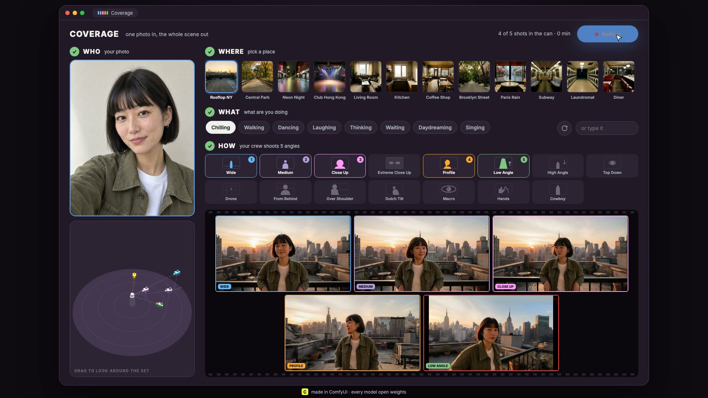
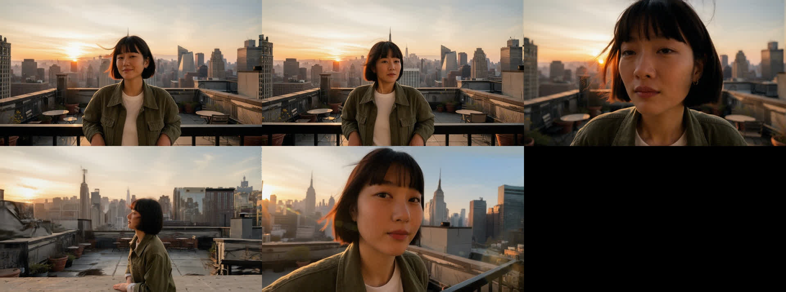
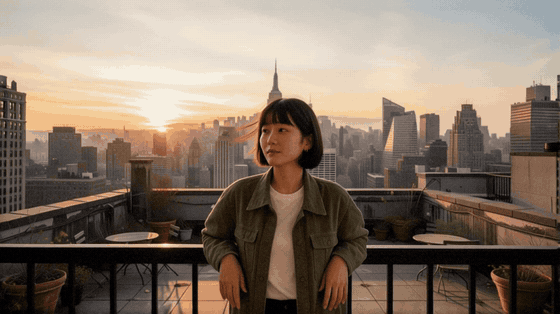
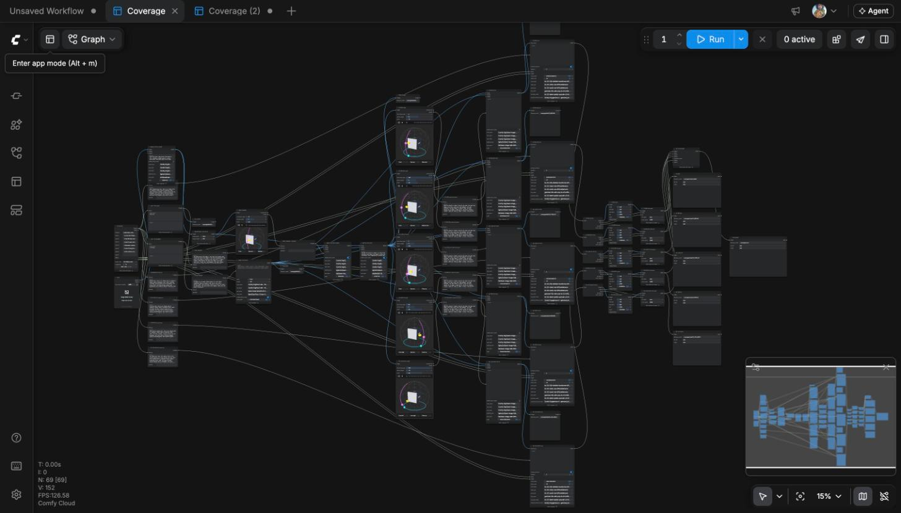

# Coverage

**One photo. Pick a place. Your own film crew shoots the whole scene.**

▶ **[Watch the demo](https://github.com/littillittil/coverage/raw/main/app/demo.mp4)** (80 seconds)



On a film set, the director never shoots just one angle. The crew shoots *coverage*: a wide, a medium, a close up, a profile, a low angle. That is what lets an editor cut a scene.

AI video gives you one shot at a time, and every new shot drifts: a new face, new light, a different room. Coverage fixes that. Give it one photo of a person (a selfie is enough), pick a place, pick what they are doing, choose five camera angles and press Run. It builds the place, puts the person in it, places five cameras around them, keeps every shot matched, gives each one a handheld camera operator, and cuts them into a scene.

Built for the ComfyUI Open Source Higgsfield competition by a working cinematographer. **Every model is open weights. LTX is the video model.**





## The app

Four steps, no prompts to write:

1. **Who**: drop in one photo. Optional **+** adds up to two more photos of the same person for a closer likeness.
2. **Where**: a library of 16 places (Rooftop NY, Neon Night, Club Hong Kong, Diner, Tokyo Alley...), or **Your Place**: upload a location photo or type a few words.
3. **What**: one word chips (Chilling, Dancing, Laughing, Daydreaming...) or type your own.
4. **How**: pick 5 of 15 shots (Wide, Close Up, Extreme Close Up, Profile, Low Angle, High Angle, Top Down, Drone, From Behind, Over Shoulder, Dutch Tilt, Macro, Hands, Cowboy). Each button shows how the shot frames you, like a storyboard.

A **3D set** shows you in the middle and each camera where it really stands, at its real height, aimed at you. Drag to look around. When you press Run, every camera's tally light blinks red while it shoots and turns green when its shot lands. Shots fill a film strip as they arrive, then the clapper snaps and the scene plays.

## How it works

One ComfyUI workflow, run on Comfy Cloud through the **Comfy API** (`comfy-sdk`).



| Step | Job | Model (all open weights) |
|---|---|---|
| 1 | Turn the selfie into a full body look of the same person | Qwen Image Edit 2511 + Consistency LoRA |
| 2 | The place: from the library, your photo, or your words | Qwen Image 2512 (the ComfyUI App mode version builds it with FLUX 2 dev) |
| 3 | Put the person in the place, then match the light | Qwen Image Edit 2511 + multiple angles LoRA, AnyLight LoRA |
| 4 | Five camera positions, each checked against the place | `CameraAngle` + Qwen Image Edit 2511 + multiple angles LoRA |
| 5 | Five 3 second handheld shots | LTX 2.5 (bf16) with its Gemma prompt helper |
| 6 | Film grain and the cut | `BetterFilmGrain`, `ConcatenateVideo` |

**The camera operator.** Locked off AI shots read as AI. Every shot is told: handheld iPhone, breathing float, small drifting reframes, focus and exposure breathing, one continuous take, subtle performance.

**The rule book.** These fast models ignore negative prompts, so the never do rules are written into every prompt: each person appears once, natural anatomy and scale, hands relaxed and empty, no text, no morphing. Every failure found in testing became a rule. One lesson worth sharing: never name an object you do not want, because naming it draws it.

## Run it

### The app (your own Comfy Cloud account)

You need Python 3.10+ and a Comfy Cloud API key ([platform.comfy.org](https://platform.comfy.org), API Keys). API access needs a paid Comfy Cloud plan; every run uses your own credits.

```bash
pip install comfy-sdk
export COMFY_API_KEY=your_key_here
python app/server.py
```

Open [http://localhost:8800](http://localhost:8800). The server stays on your machine and keeps your key there; the page never sees it. A run takes about 20 minutes at best quality. The 3D set loads three.js from a CDN, so keep an internet connection.

### In ComfyUI

**Comfy Cloud:** open [cloud.comfy.org](https://cloud.comfy.org), drag `workflows/coverage.app.json` onto the page, add a photo, pick a situation, press Run. It opens in App mode with two controls. Every model is already on Comfy Cloud.

**Your own ComfyUI:** update to the latest ComfyUI (it uses the core `CameraAngle`, `CustomCombo`, `RegexReplace`, `ResolutionSelector` and `ConcatenateVideo` nodes), install **ComfyUI-Image-Filters** from the Manager (for `BetterFilmGrain`), drag in the workflow, and download the models listed in the official templates in `templates/`.

**No photo handy?** Try one of the sample people in `examples/people`: Maya, Kenji, Priya and Mateo, made with open weights inside ComfyUI.

## Make it yours

- `app/places.json`: the place library. Add a line and a picture in `app/places/`.
- `app/shots.json`: the shot menu. `h` is the camera's position around the subject (0 front, 90 side), `v` its height (negative looks up), `zoom` from 0 wide to 10 close.
- `app/actions.json`: the action words.
- `tools/build_coverage.py`: the workflow itself, built from the official Comfy templates: the camera operator, the rule book, the light match. Rebuild with `python tools/build_coverage.py`.

## What's next

Your own voice or a song driving the performance with LTX audio to video, so all five cameras shoot the same take like a multi cam music video · swipe to keep or reject shots, where rejects grow the rule book · two people per scene · story mode across scenes.

## License

MIT. See [LICENSE](LICENSE).

Made by Littil Swayamp, cinematographer and director, Los Angeles. [littil.ai](https://littil.ai)
